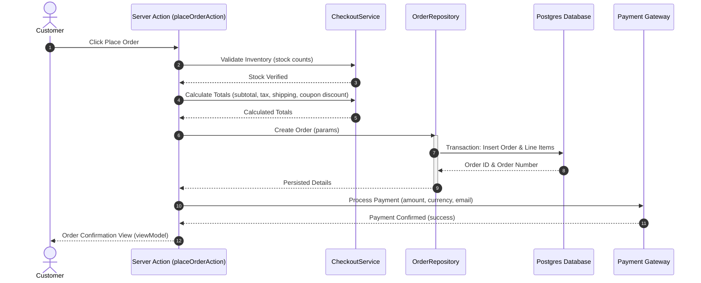
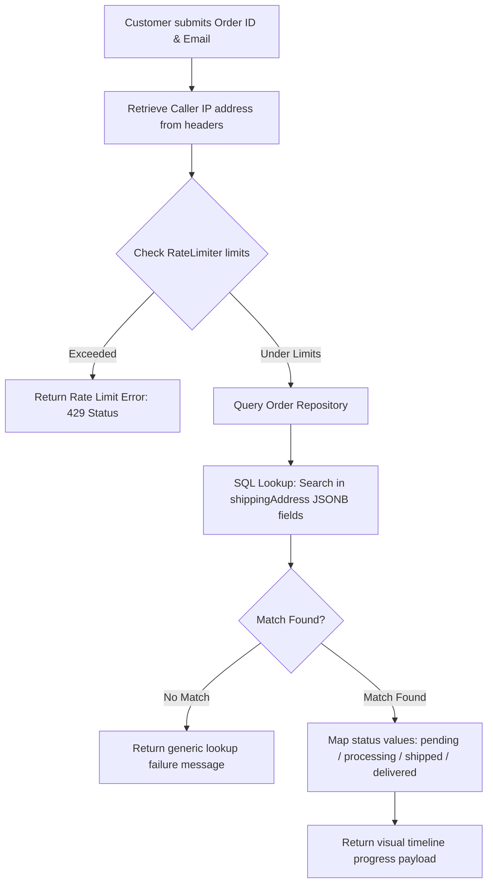

# Request and Data Flow

This document details how requests travel through domain layers for core application features.

## 1. Checkout and Order Placement

The checkout pipeline handles stock reservation, total calculations, transaction payment, and database storage inside a single, secure sequence:



---

## 2. Guest Order Tracking

The public guest tracking flow implements security measures (rate limits and data exposure controls) to prevent harvesting order information:



---

## 3. Supabase Auth Redirects

Secure verification callbacks map state transitions upon user email confirmations, magic link clicks, and OAuth redirect responses:

```text
Supabase Email Verification Link
              ↓
  Redirects with auth code (?code=...)
              ↓
  [GET] /auth/callback/route.ts
              ↓
  Exchanges code for cookies session (Supabase client)
              ↓
  Verifies local environment variables / origins
              ↓
  Redirects to customer dashboard (/account)
```
