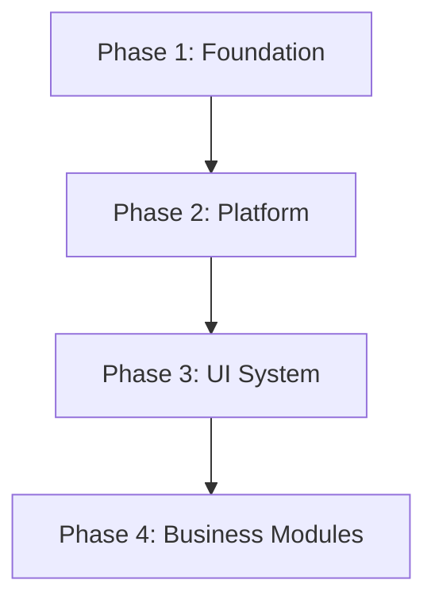

# Production-Grade Next.js + Supabase Starter Template Plan

This checklist outlines the architecture, setup, and features for a robust, production-grade Next.js + Supabase Starter Template, serving as the blueprint for future SaaS and e-commerce client projects.

---

## 1. Project Setup & Packages

Install all core dependencies and dev tools upfront:
* [ ] Initialize Next.js 15+ App Router, TypeScript, ESLint, Tailwind CSS
* [ ] Install production dependencies:
  * `next`, `react`, `react-dom`
  * `@supabase/supabase-js`, `@supabase/ssr`
  * `zod`
  * `react-hook-form`, `@hookform/resolvers`
  * `clsx`, `tailwind-merge`
  * `lucide-react`
  * `next-themes`
  * `sonner`
  * `@tanstack/react-table`, `@tanstack/react-virtual`
  * `date-fns`
* [ ] Install dev dependencies:
  * `typescript`, `postcss`, `autoprefixer`, `tailwindcss`
  * `husky`, `lint-staged`
  * `eslint`, `prettier`

---

## 2. Directory Structure

```text
src/
  actions/                  # Global or cross-cutting Server Actions
  app/                      # Next.js pages/routes, layouts, API routes
  components/               # Shared frontend UI components
    ui/                     # Component library layout
      atoms/                # Base elements (Button, Input, Badge, Switch, etc.)
      molecules/            # Composite elements (FormField, DatePicker, SelectField)
      organisms/            # Complex controls (Modal, Drawer, DynamicForm, DataTable)
    layout/                 # Frame elements (Sidebar, Header, Footer)
    feedback/               # Global feedback elements (Toasts, Loading overlays, Empty states)
    navigation/             # Navigation controls (Breadcrumbs, SidebarMenu)
  core/                     # Shared backend, business, and library setups
    auth/                   # Auth helpers, middleware rules, session access
    cache/                  # Next.js cache tags, revalidation rules
    config/                 # Typed configurations (no magic strings)
    constants/              # Shared constants (routes, permissions, etc.)
    database/               # Supabase schema generation & RPC helpers
    email/                  # E-mail provider setup, templates, interfaces
    errors/                 # App custom error classes & handling definitions
    events/                 # Event dispatching (decoupled workflows)
    http/                   # API Response helpers and pagination schemas
    logger/                 # Structured logs, audit events, request logs
    permissions/            # RBAC utilities and client/server checks
    security/               # Security controls (headers, cookies, sanitization)
    storage/                # Storage wrapper (upload, delete, signed URLs)
    utils/                  # Unit-utility functions (date, currency, etc.)
    validation/             # App-wide validation schemas (Zod)
  hooks/                    # Custom global React hooks
  lib/                      # Third-party client instances (Supabase, query clients)
  modules/                  # Feature modules (contains routing-independent logic)
    products/               # Products module components, actions, state
    customers/              # Customers module components, actions, state
    inventory/              # Inventory module components, actions, state
    orders/                 # Orders module components, actions, state
    settings/               # Settings module components, actions, state
    shared/                 # Shared module helpers
  providers/                # Context providers (Theme, Supabase, Toast)
  services/                 # Third-party domain service clients (email, sms, search)
  styles/                   # Tailwind layers, custom globals
  types/                    # Global/Shared TypeScript definitions
scripts/                    # CLI tools, seeding, database migrations, module generation
docs/                       # Architecture, coding standards, deployment guides
tests/                      # Testing architecture (unit, integration, fixtures)
.github/                    # CI/CD Workflows
```

---

## 3. Foundation Components (Phase 1)

### Environment Validation (`core/validation/`)
Ensure runtime and compile-time validation for:
* [ ] `NODE_ENV`
* [ ] `NEXT_PUBLIC_APP_URL`
* [ ] `NEXT_PUBLIC_SUPABASE_URL`
* [ ] `NEXT_PUBLIC_SUPABASE_ANON_KEY`
* [ ] `SUPABASE_SERVICE_ROLE_KEY`
* [ ] `SMTP_HOST`, `SMTP_PORT`, `SMTP_USERNAME`, `SMTP_PASSWORD`
* [ ] `RESEND_API_KEY`
* [ ] `RAZORPAY_KEY`, `RAZORPAY_SECRET`
* [ ] Dedicated folders for validation structures:
  * `schemas/`
  * `validators/`

### Config System (`core/config/`)
All application settings derived from environments, loaded statically:
* [ ] `app.ts` (names, version, URLs, environments)
* [ ] `auth.ts` (session settings, paths)
* [ ] `storage.ts` (buckets, limits, extensions)
* [ ] `email.ts` (sender details, defaults)
* [ ] `cache.ts` (revalidation times, tags)
* [ ] `security.ts` (CORS rules, cookie settings)
* [ ] `features.ts` (Feature Flags: wishlist, coupons, reviews, blog, etc.)
* [ ] `meta.ts` (Metadata defaults: Title, Description, OpenGraph, Twitter, Icons, Manifest)

### Constants (`core/constants/`)
* [ ] `routes.ts` (paths, external links)
* [ ] `permissions.ts` (permissions map)
* [ ] `roles.ts` (RBAC role names)
* [ ] `status.ts` (order/product statuses)
* [ ] `regex.ts` (phone numbers, slugs, passwords)
* [ ] `storage.ts` (bucket names)
* [ ] `api.ts` (API routes, configurations)
* [ ] `events.ts` (Event name constants)
* [ ] `cookies.ts` (Cookie keys)

### Unified Custom Error System (`core/errors/`)
Create distinct error categories inherits from a base error class:
* [ ] `AppError` (base custom class)
* [ ] `ValidationError`
* [ ] `DatabaseError`
* [ ] `AuthenticationError`
* [ ] `AuthorizationError`
* [ ] `NotFoundError`

### Structured Utilities (`core/utils/`)
* [ ] `date.ts` (formatting, comparisons, time zones)
* [ ] `currency.ts` (formatting, conversion helpers)
* [ ] `slug.ts` (URL slugs generation)
* [ ] `string.ts` (truncation, formatting, cleanups)
* [ ] `number.ts` (safe parses, averages)
* [ ] `file.ts` (size formatting, mime checks)
* [ ] `pagination.ts` (offset/limit calcs)
* [ ] `object.ts` (deep merge, omit/pick)

### Structured Logger (`core/logger/`)
* [ ] `index.ts` (Console logs, level validation)
* [ ] `audit.ts` (Audit trail log schemas)
* [ ] `request.ts` (Request/Response logs)

### Security Helper Layers (`core/security/`)
* [ ] `headers.ts` (CSP, CORS, anti-clickjacking)
* [ ] `sanitize.ts` (HTML sanitization)
* [ ] `origin.ts` (Origin validation helpers)
* [ ] `cookies.ts` (Secure cookie setup)

### Caching Wrappers (`core/cache/`)
* [ ] `tags.ts` (Predefined next.js tag strings)
* [ ] `cache-keys.ts` (Cache keys factory)
* [ ] `revalidate.ts` (Revalidate methods mapping tags)

### Email Abstraction (`core/email/`)
* [ ] `client.ts` (SMTP/API gateway instance client)
* [ ] `providers/` (SES, Resend, etc. provider interfaces)
* [ ] `templates/` (Welcome, password reset, transaction templates)
* [ ] `types.ts` (Email parameter types)
* [ ] `service.ts` (Abstraction layer routing to providers)

### Storage Abstraction (`core/storage/`)
* [ ] `client.ts` (Storage gateway client)
* [ ] `buckets.ts` (Storage buckets mapping)
* [ ] `upload.ts` (Upload abstraction)
* [ ] `download.ts` (File download abstraction)
* [ ] `signed-url.ts` (Signed URLs)
* [ ] `delete.ts` (Safe deletes)

### API response helpers (`core/http/`)
* [ ] `response.ts` (Unified response objects: success, bad request, unauthorized, server error)
* [ ] `pagination.ts` (Consistent pagination structure wrappers)

### Provider Layer (`providers/`)
* [ ] `ThemeProvider.tsx` (Theme toggle)
* [ ] `SupabaseProvider.tsx` (Client session context provider)
* [ ] `ToastProvider.tsx` (Toast alert configurations)

### Events Dispatcher (`core/events/`)
* [ ] `dispatcher.ts` (PubSub dispatcher for decoupled system actions)

### CLI Scripts (`scripts/`)
* [ ] `seed.ts` (Development data hydration script)
* [ ] `reset.ts` (Recreate database environment wrapper)
* [ ] `generate-module.ts` (Scaffold new modules)
* [ ] `check-env.ts` (CLI environment verification check)
* [ ] `generate-rpc.ts` (Supabase RPC type generator)
* [ ] `generate-resource.ts` (Scaffold database/api resources)

### Testing (`tests/`)
* [ ] Structure for:
  * `unit/`
  * `integration/`
  * `fixtures/`

---

## 4. Platform & Supabase Integration (Phase 2)

* [ ] Configured Supabase Clients (Server client, Client client, Middleware client)
* [ ] JWT Authentication & Middleware:
  * Route guard matching public/private paths
  * Role-based redirections
* [ ] Database Schema:
  * Users profiles table linked to `auth.users`
  * System roles and user role assignment mapping tables
  * Base system auditing columns (`created_by`, `updated_by`, `deleted_at`)
* [ ] Server Action Wrappers:
  * Error boundary wrapper catching custom typed errors
  * Validation middleware automatically checking input arguments using Zod
  * Role-based access validation

---

## 5. UI System & Design (Phase 3)

* [ ] Dark/Light theme toggle using global state
* [ ] Atomic elements (Buttons, Inputs, Selects, Switches, etc.)
* [ ] Reusable Form Builder with validation feedback
* [ ] Reusable Data Table (sorting, paginating, filtering, columns, selection, exports)
* [ ] Modal, Dialog, and Drawer containers
* [ ] Toast notification configurations
* [ ] Unified feedback states (Loaders, Skeletons, Error layout, Empty lists)

---

## 6. Business Modules (Phase 4)

Each module implementing CRUD logic following the system standards:
* [ ] Products module (details, inventory linking)
* [ ] Categories module (hierarchies, slugs)
* [ ] Customers module (profiles, history)
* [ ] Inventory module (stock alerts, adjustments)
* [ ] Orders module (line items, transactions)
* [ ] Settings module (branding, appearance, localization)

---

# Suggested Development Roadmap



### Phase 1 — Foundation
1. Next.js app initialization (App Router, TS, ESLint, Tailwind)
2. Dependency installation (production + dev dependencies)
3. Folder architecture setup
4. Prettier/ESLint environment files, Husky git hooks, Github CI Workflow setup
5. Environment variables validation schema
6. Config System (app, auth, storage, email, cache, security, features, meta)
7. Constants (routes, permissions, roles, status, regex, storage, api, events, cookies)
8. Custom Error definitions (AppError, ValidationError, etc.)
9. Core utilities structuring
10. Logger index, audit, and request logging
11. Secure API response/http utilities
12. Global state providers (Theme, Supabase client structure, Toast)
13. Security helpers (headers, sanitize, origin, cookies)
14. Cache keys and revalidate helpers
15. Email client and service providers
16. Storage abstraction setup
17. Events dispatcher
18. CLI helpers setup (seed, reset, generate module, check-env, etc.)
19. Testing folders setup
20. Foundation architecture documentation (`docs/coding-standards.md`, etc.)
